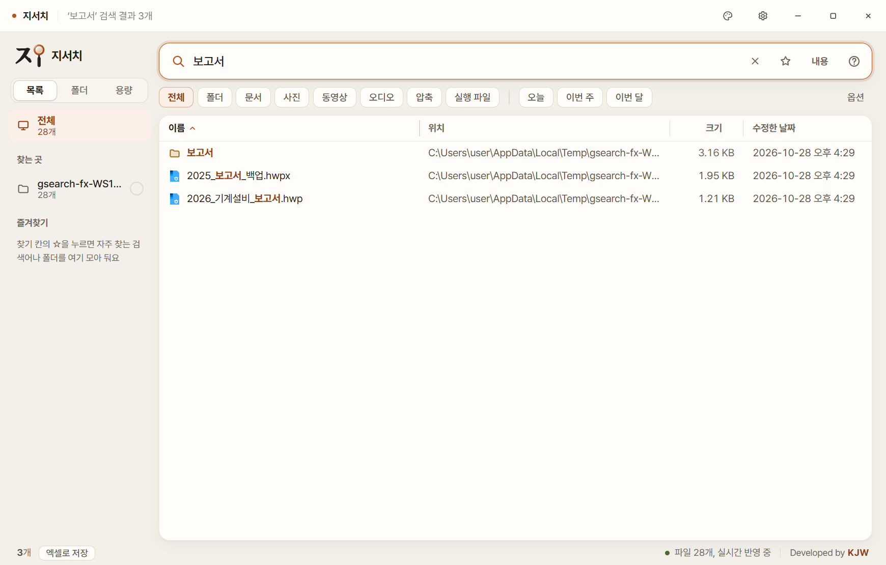
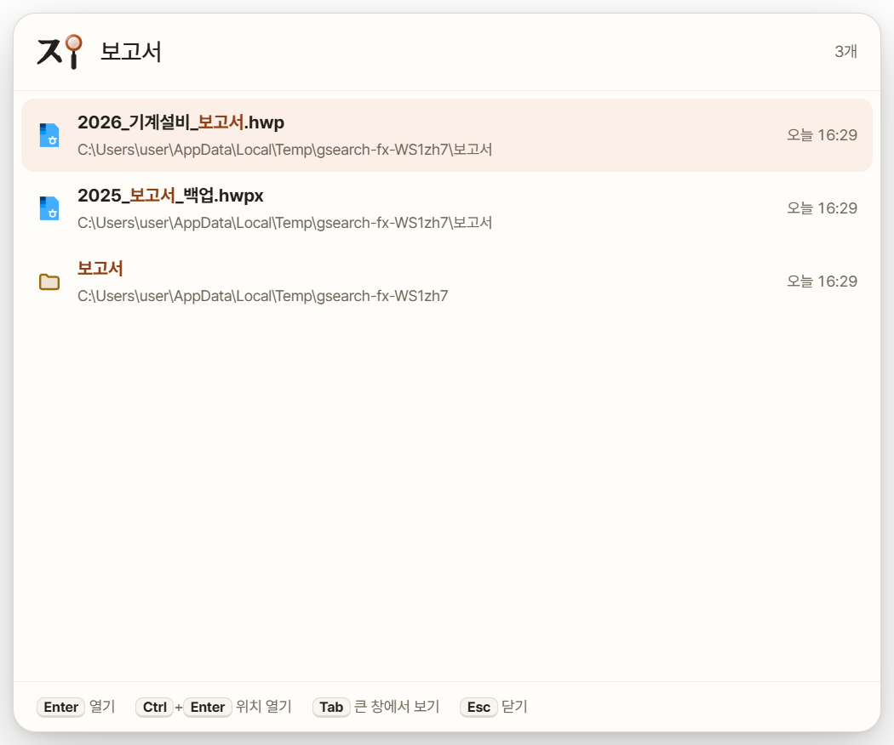

# 지서치 · GSearch

내 PC의 파일·폴더 이름을 치는 즉시 찾아 주는 Windows 프로그램. Developed by **KJW**.

**[최신 버전 다운로드](https://github.com/jiwooouuu/gsearch/releases/latest)**

## 설치

1. 최신 릴리스에서 `GSearch_Setup.exe`를 다운로드합니다.
2. 설치 프로그램을 실행합니다. 기존 설치가 있으면 같은 위치에 설치하고 설정과 파일 목록은 그대로 둡니다.
3. 바탕 화면 또는 시작 메뉴의 **지서치**를 실행합니다.

Windows 10/11 64비트용입니다. 관리자 권한 없이 설치하고 실행합니다.
처음 실행할 때 Windows가 "PC 보호" 창을 띄우면 **추가 정보 → 실행**을 누르면 됩니다.

처음 켜면 고정 드라이브의 파일 목록을 만듭니다. 드라이브 크기에 따라 몇 분 걸릴 수 있고, 그동안에도 검색할 수 있습니다. 다음부터는 저장한 목록을 바로 불러오고 꺼져 있던 동안 바뀐 파일만 반영합니다.

## 주요 기능

- 파일·폴더 이름을 칠 때마다 바로 찾기 (초성 검색, 여러 단어, 빼기, 확장자·크기·날짜 조건)
- 드라이브와 폴더(나스 공유 폴더 포함)를 골라 찾는 곳으로 지정, 여러 곳을 골라 그 안에서만 찾기
- 목록 보기 · 탐색기처럼 폴더를 따라 들어가는 폴더 보기 · 큰 파일과 큰 폴더, 이름과 크기가 같은 파일을 보여 주는 용량 보기
- 파일 내용으로 찾기: 한글(hwp·hwpx), 워드, 엑셀, 파워포인트, PDF, 글 파일 안의 글자
- 스페이스바 미리보기: 그림·영상·글 파일·문서 내용과 폴더 안 목록
- 오늘·이번 주·이번 달 날짜 단추, 검색 기록과 즐겨찾기
- 검색 결과를 엑셀 파일로 저장
- 어디서든 단축키(기본 Ctrl+Alt+F)로 부르는 작은 검색창
- 파일이 생기고 지워지고 바뀌는 것을 실시간으로 반영
- 테마 10종, 앱 안 로고도 테마 색을 따라 바뀜

지서치는 파일을 지우거나 옮기지 않습니다. 찾고, 열고, 위치를 열고, 복사하는 것만 합니다.

## 이렇게 입력해 보세요

| 입력 | 찾는 것 |
| --- | --- |
| `보고서 2026` | 두 단어가 모두 들어간 파일 |
| `견적\|계약` | 둘 중 하나라도 들어간 파일 |
| `보고서 !백업` | ‘백업’이 들어간 건 빼고 |
| `ㄱㅈㅅ` | 초성으로 찾기 (견적서) |
| `*.pdf` | PDF 파일만 |
| `ext:hwp;hwpx` | 한글 파일만 |
| `size:>100mb` | 100MB보다 큰 파일 |
| `dm:오늘` | 오늘 수정한 파일 |
| `folder:` | 폴더만 보기 |

옵션 단추에서 경로 포함(폴더 이름까지 함께 찾기), 대소문자 구분, 정규식을 켤 수 있습니다.

## 단축키

| 기능 | 단축키 |
| --- | --- |
| 열기 | Enter |
| 파일 위치 열기 | Ctrl+Enter |
| 미리보기 | Space |
| 파일 복사 · 경로 복사 | Ctrl+C · Ctrl+Shift+C |
| 엑셀로 저장 | Ctrl+S |
| 즐겨찾기 | Ctrl+D |
| 파일 내용으로 찾기 | Ctrl+Shift+F |
| 목록·폴더·용량 보기 | Ctrl+1 · 2 · 3 |
| 작은 검색창 | Ctrl+Alt+F (설정에서 변경) |

## 업데이트

앱을 켤 때 이 저장소의 최신 릴리스를 확인합니다. 새 버전이 있으면 아래 상태 줄에 **새 버전 받기** 단추가 나타납니다. 받은 설치 파일은 SHA-256으로 확인한 뒤 실행하며, 단추를 누르기 전에는 받거나 설치하지 않습니다.

**설정 → 정보 → 지금 확인**으로 직접 확인할 수 있고, **새 버전이 나오면 알려 주기**를 끄면 켤 때 확인하지 않습니다.

## 개인 정보

파일 목록과 설정은 이 PC(`%APPDATA%\지서치`)에만 저장합니다. 인터넷은 새 버전 확인과 받기에만 쓰고, 파일 이름이나 검색어는 어디로도 보내지 않습니다.

## 구성과 안내

이 저장소는 설치 파일과 사용 안내를 배포하는 공간입니다. 설치 파일은 **Releases**, 변경 사항은 **CHANGELOG.md**, 화면 예시는 **assets/**에 있습니다.

앱은 Electron, PDF.js, Pretendard, Noto Serif KR(로고 글자 모양)을 사용하며 각 구성 요소의 라이선스가 적용됩니다. 지서치의 별도 오픈소스 라이선스는 부여하지 않습니다.
